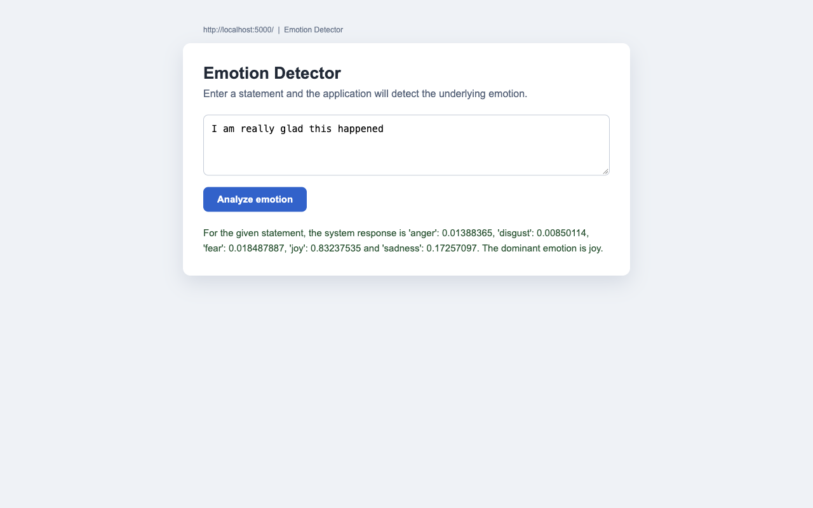
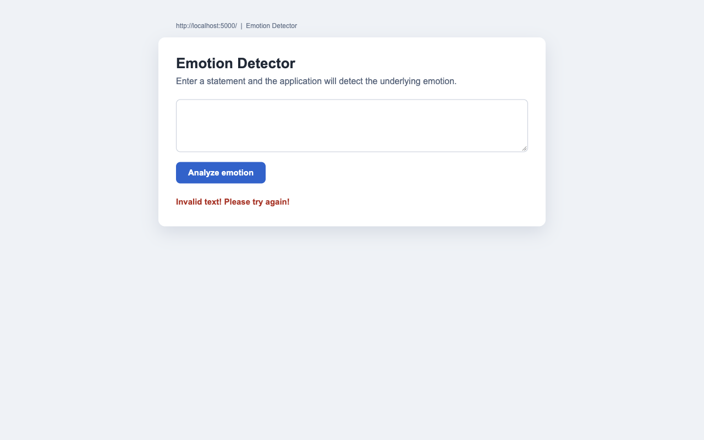

# Final Project: Emotion Detector

AI-based web application that detects the emotion expressed in a customer's text
using the **Embeddable Watson AI libraries** (`EmotionPredict` from IBM Watson NLP).

The application is built with **Python**, packaged as the `EmotionDetection`
module, tested with **unittest**, analysed with **PyLint**, and deployed as a web
app using **Flask**.

## Project structure

```
.
├── EmotionDetection/
│   ├── __init__.py
│   ├── emotion_detection.py
│   └── templates/
│       └── index.html
├── test_emotion_detection.py
├── server.py
├── requirements.txt
├── pylintrc
├── 6b_deployment_test.png
└── 7c_error_handling_interface.png
```

## Emotion detection application

`EmotionDetection/emotion_detection.py` exposes `emotion_detector(text_to_analyze)`,
which calls the Watson NLP `EmotionPredict` endpoint and returns the scores for
anger, disgust, fear, joy and sadness together with the `dominant_emotion`.

```python
from EmotionDetection.emotion_detection import emotion_detector

emotion_detector("I am really glad this happened")
# {'anger': 0.0138, 'disgust': 0.0085, 'fear': 0.0184,
#  'joy': 0.8323, 'sadness': 0.1725, 'dominant_emotion': 'joy'}
```

Blank input and API failures return `None` for every score and for the
dominant emotion, which the Flask layer converts into
`Invalid text! Please try again!`.

## Flask deployment

`server.py` exposes:

* `GET /` — renders the user interface (`templates/index.html`).
* `GET /emotionDetector?textToAnalyze=...` — returns the formatted emotion summary.

```bash
python3 server.py
# serving on http://localhost:5000
```



## Error handling

Invalid (blank) input returns the message **Invalid text! Please try again!**
both from the API endpoint and in the web interface.



## Unit tests

```bash
python3 -m unittest -v test_emotion_detection
```

```
test_anger  ... ok
test_disgust ... ok
test_fear   ... ok
test_joy    ... ok
test_sadness ... ok
----------------------------------------------------------------------
Ran 5 tests in 0.559s

OK
```

## Static code analysis

```bash
python3 -m pylint --rcfile=pylintrc server.py EmotionDetection
```

```
--------------------------------------------------------------------
Your code has been rated at 10.00/10
```

## Package validation

```python
from EmotionDetection.emotion_detection import emotion_detector
```

The import resolves through `EmotionDetection/__init__.py`, confirming that
`EmotionDetection` is a valid Python package.
